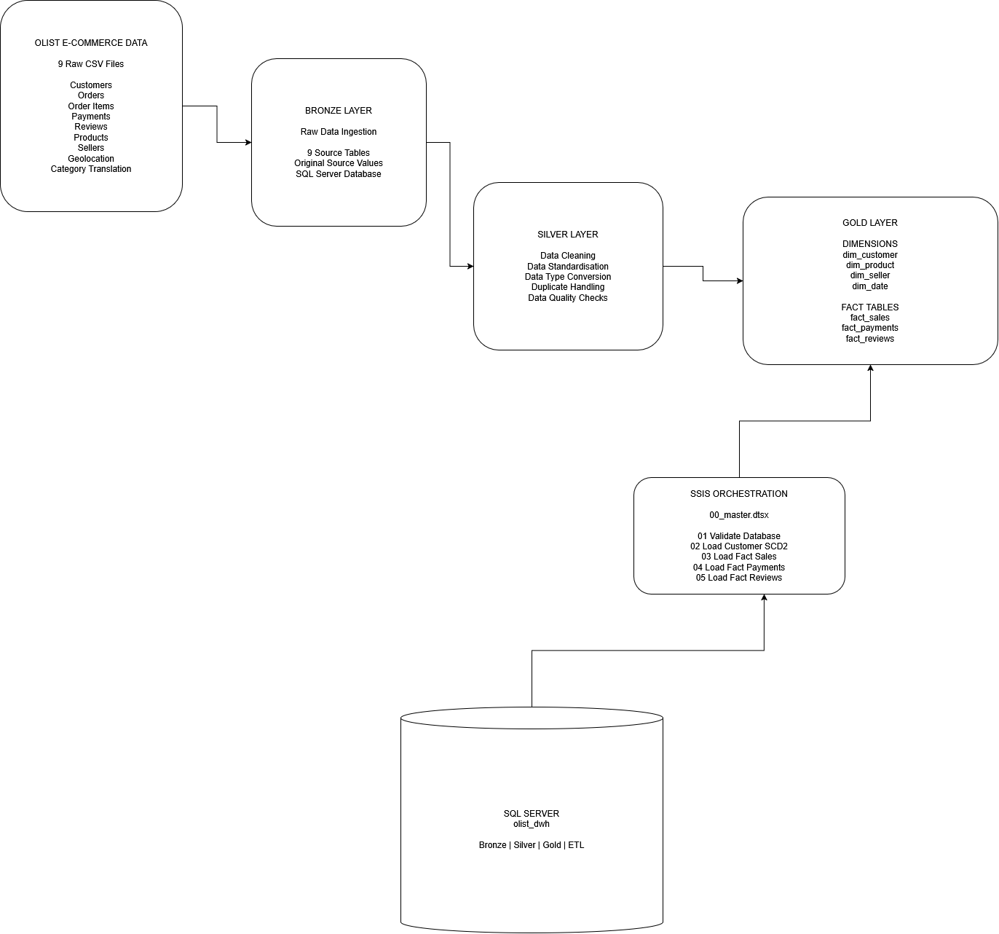

# Olist E-Commerce Data Warehouse

## Overview

An end-to-end e-commerce data warehouse project built using Microsoft SQL Server, SQL Server Integration Services (SSIS), and a Bronze-Silver-Gold medallion architecture.

The project uses the Olist Brazilian E-Commerce Public Dataset to demonstrate data warehousing, dimensional modelling, data quality validation, SQL development, ETL orchestration, and version control.

## Architecture



See the [Architecture Documentation](docs/architecture.md) for more details.

### Medallion Architecture

- **Bronze:** Raw source data stored in SQL Server staging tables.
- **Silver:** Cleaned, standardized, and typed data prepared for analytical modelling.
- **Gold:** Business-ready dimensional models and fact tables for reporting and analysis.

## Technology Stack

- Microsoft SQL Server
- SQL Server Management Studio (SSMS)
- SQL Server Integration Services (SSIS)
- T-SQL
- Git and GitHub
- Draw.io and Mermaid for architecture documentation

## Source Dataset

**Olist Brazilian E-Commerce Public Dataset**

Source: [Kaggle – Olist Brazilian E-Commerce Dataset](https://www.kaggle.com/datasets/olistbr/brazillian-ecommerce)

The dataset includes information about customers, geolocation, orders, order items, payments, reviews, products, sellers, and product category translations.

Original CSV files are maintained locally and excluded from GitHub to avoid committing large source datasets.

## Data Warehouse Design

The warehouse is implemented in the `olist_dwh` SQL Server database.

### Bronze Layer

Contains nine source tables representing the original Olist datasets.

### Silver Layer

Contains nine standardized tables with typed date fields and cleaned data structures.

### Gold Layer

The Gold layer contains four dimension tables:

| Dimension | Purpose |
|---|---|
| dim_customer | Customer attributes and SCD Type 2 history |
| dim_date | Calendar and date analysis |
| dim_product | Product and category attributes |
| dim_seller | Seller identification and location |

It also contains three fact tables:

| Fact table | Grain |
|---|---|
| fact_sales | One row per order item |
| fact_payments | One row per payment line |
| fact_reviews | One row per review and order |

Surrogate keys are used in the dimensional model. An unknown dimension member is represented using key `-1`.

The customer dimension supports Slowly Changing Dimension Type 2 (SCD2), preserving historical customer records through effective dates and current-record indicators.

## ETL and Orchestration

SQL Server stored procedures implement customer SCD Type 2 processing and fact-table loading.

The SSIS master package, `00_master.dtsx`, orchestrates the following workflow:

1. Validate the database.
2. Load customer dimension changes using SCD Type 2.
3. Load the sales fact table.
4. Load the payments fact table.
5. Load the reviews fact table.

The package has been executed successfully.

The Bronze and Silver SQL scripts define the table structures. The full raw-file-to-Gold loading process is not yet completely automated through SSIS.

## Data Quality and Validation

A dedicated SQL data-quality test script is available at:

`tests/01_data_quality_tests.sql`

The project includes checks for data integrity, duplicate records, missing values, and dimensional consistency.

The ten implemented data-quality checks completed with zero failures.

## Current Warehouse Results

The verified Gold layer contains:

| Table | Records |
|---|---:|
| dim_customer | 96,097 |
| dim_date | 1,828 |
| dim_product | 32,952 |
| dim_seller | 3,096 |
| fact_sales | 112,650 |
| fact_payments | 103,886 |
| fact_reviews | 99,224 |
| **Total** | **509,233** |

These counts include the unknown dimension members where applicable.

## Repository Structure

```text
olist_ssis_dwh/
├── data/
│   ├── README.md
│   └── raw/                         # Local source CSV files
├── sql/
│   ├── bronze/
│   │   └── 01_create_bronze_tables.sql
│   ├── silver/
│   │   └── 02_create_silver_tables.sql
│   ├── gold/
│   │   └── 03_create_gold_tables.sql
│   └── etl/
│       ├── 04_customer_scd2_procedure.sql
│       └── 05_fact_load_procedures.sql
├── ssis/                            # SSIS solution and packages
├── tests/
│   └── 01_data_quality_tests.sql
├── docs/
│   ├── architecture.md
│   ├── olist_data_warehouse_architecture.drawio
│   └── olist_data_warehouse_architecture.drawio.png
├── .gitignore
└── README.md
```

## How to Run

1. Install SQL Server and SQL Server Management Studio.
2. Create or select the `olist_dwh` database.
3. Execute the Bronze, Silver, and Gold table-creation scripts in order.
4. Execute the ETL procedure scripts.
5. Open and configure the SSIS solution and its connection manager.
6. Execute the master SSIS package.
7. Run the data-quality test script to validate the warehouse.

Note: The table-creation scripts create missing objects; they do not load source CSV data. The database loading and transformation steps must be completed using the project's existing loading processes and procedures.

## Future Improvements

- Complete automated raw-to-Gold ingestion and transformation orchestration.
- Add automated pipeline logging and failure handling.
- Expand incremental loading and change detection.
- Develop Power BI dashboards and analytical reports.
- Add further reconciliation and performance testing.

## Disclaimer

This is an educational data engineering portfolio project using a publicly available dataset. It is not affiliated with Olist.
