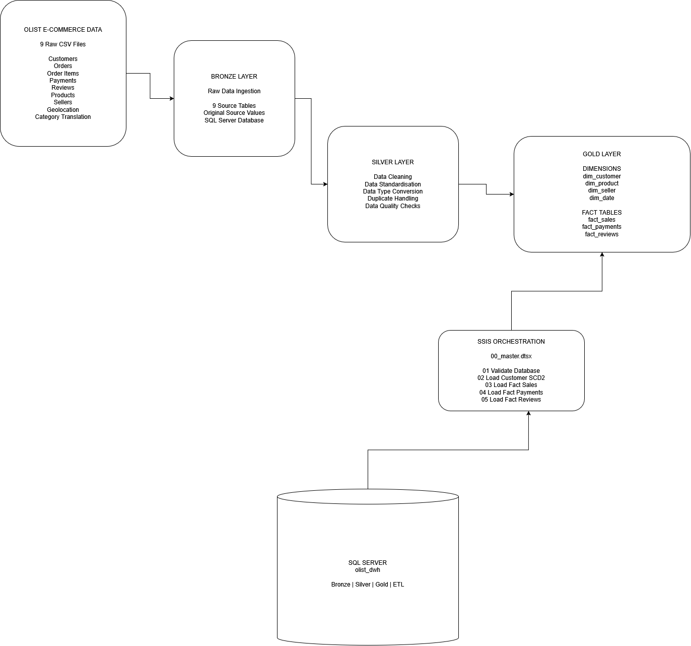
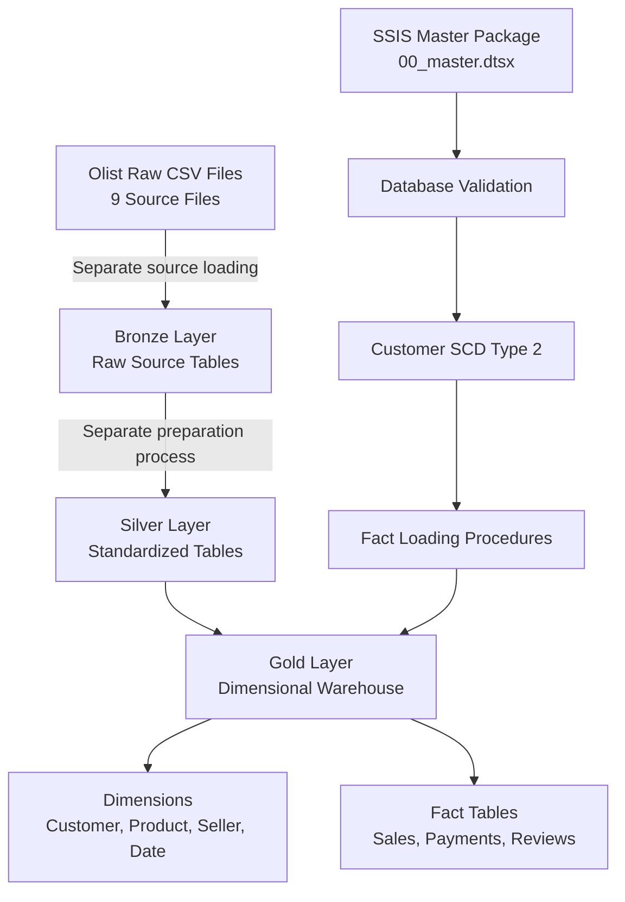

# Olist E-Commerce Data Warehouse Architecture

## Overview

This project implements an e-commerce data warehouse using Microsoft SQL Server, SQL Server Integration Services (SSIS), and a Bronze-Silver-Gold medallion architecture.

## Data Flow

Olist Raw CSV Files → Bronze → Silver → Gold

- **Bronze:** Stores the nine source datasets in SQL Server tables.
- **Silver:** Contains standardized and prepared source data.
- **Gold:** Contains business-ready dimensional models and fact tables.

**Important:** Raw CSV ingestion and Silver-layer preparation are not yet fully automated in the repository. The source data is loaded and prepared separately before the Gold loading procedures are executed.

## Gold Layer

### Dimension Tables

- `dim_customer` — Customer attributes and SCD Type 2 history.
- `dim_product` — Product and category attributes.
- `dim_seller` — Seller attributes.
- `dim_date` — Calendar attributes.

### Fact Tables

- `fact_sales` — One row per order item.
- `fact_payments` — One row per payment line.
- `fact_reviews` — One row per review and order.

Unknown dimension members use surrogate key `-1`.

## ETL and SSIS Orchestration

SQL Server stored procedures implement customer SCD Type 2 processing and fact-table loading.

The SSIS master package, `00_master.dtsx`, executes these tasks in sequence:

1. Validate the database.
2. Load customer dimension changes using SCD Type 2.
3. Load the sales fact table.
4. Load the payments fact table.
5. Load the reviews fact table.

The package does not currently automate the complete raw CSV ingestion and Silver transformation process.

## Database

**Database:** `olist_dwh`

**Schemas:**

- `bronze`
- `silver`
- `gold`
- `etl`

## Architecture Diagram

## Mermaid Architecture Diagram

